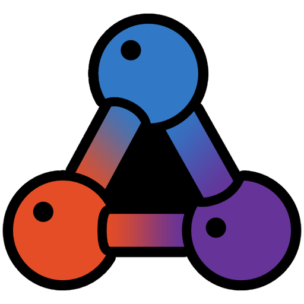

<h1 align="center">WEB Development made simple and fun again</h1>

<p align="center">
  
</p>

<h1 align="center">nuBond</h1>

<p align="center">
  <strong>A declarative TypeScript progressive framework with Web Components, Shadow DOM, and an attribute-driven binding system.</strong>
</p>

<p align="center">
  <a href="https://www.npmjs.com/package/nubond"></a>
  <a href="LICENSE"></a>
  
  
  
  
</p>

---

## What is nuBond?

nuBond is a lightweight UI framework for building reactive progressive web applications in TypeScript that respects vanilla web development. It pairs **Web Components and Shadow DOM** with a familiar **decorator + HTML/CSS templates** authoring model, an **attribute-based binding system**, **dependency injection**, **routing**, and **automatic change detection** — all in one cohesive package.

## Why nuBond?
- **Simple** — 15 minutes and you know all the basics, 15 minutes more and you know everything
- **No dependencies** — the framework has no runtime dependencies; `tslib` is the only build dependency (everything else is test tooling)
- **Lightweight** — as lightweight as possible without compromising functionality
- **Fast** — blazingly fast performance at any application size
- **Feature rich** — powerful and feature rich, no compromises and no limitations
- **Portable** — can be compiled into a single JavaScript file
- **Easy migration** — can co-exist with other UI frameworks/libraries on the same page and integrate with them

## Highlights

- **Declarative templates** — `nb-value`, `nb-class`, `nb-if`, `nb-repeat`, `nb-event:click`, and more.
- **Decorator-based metadata** — `@AppRoot`, `@Container`, `@Component`, `@Aspect`, `@Transformer`, `@Injectable`.
- **Web Components first** — components are real Custom Elements with isolated Shadow DOM and scoped styles.
- **Built-in DI** — constructor injection with singleton or transient lifetimes.
- **Automatic change detection** — automatically triggered based on events and input changes, with the ability to trigger manually via injection or the `@Detector()` / `@Eventer()` decorators.
- **Routing** — hash-based or path-based routing with declarative slot binding (`nb-container="%slot"`).
- **Aspects** — reusable element-level behaviors that mix into any element without creating a new scope.
- **Transformers** — global pure functions usable from any expression (`{{ dateFormat(...) }}`).
- **Content projection** — powerful HTML template processing based on named and default slots with append-or-replace semantics.
- **Adopted styles** — share `CSSStyleSheet` instances across components.
- **W3C compliance mode** — switch from `nb-*` to `data-nb-*` attributes when strict HTML conformance is required.

## How it compares

| | **nuBond** | **Angular** | **Vue** | **React** |
|---|---|---|---|---|
| Templates | ✅ Plain `.html` files + `nb-*` attributes | Angular template syntax | SFC / in-DOM templates | JSX inside JavaScript |
| Template compiler needed | ✅ No — plain `tsc` | Yes (Angular compiler) | Yes, for SFCs | Yes (JSX transform) |
| State | ✅ Plain class fields, change detection runs automatically | Signals (`signal`, `set`, `update`) | Reactive proxies (`ref`, `reactive`) | Immutable state + hooks |
| Components are native Web Components | ✅ Always (Custom Element + Shadow DOM) | Opt-in (Angular Elements) | Opt-in (`defineCustomElement`) | ❌ |
| Style isolation | ✅ Native Shadow DOM + shared adopted stylesheets | Emulated by default | `scoped` (emulated) | ❌ Not built in |
| Dependency injection | ✅ Built in | ✅ Built in | `provide` / `inject` | ❌ Context only |
| Router | ✅ Built in | ✅ Built in | Separate package | Third-party |
| Runtime dependencies | ✅ None | RxJS, tslib | None | None |
| Server-side rendering | ❌ | ✅ | ✅ | ✅ |
| Learning curve | ✅ Low — a handful of decorators, ~20 `nb-*` attributes | Steep | Gentle | Moderate |

### Performance

The same data-table app (js-framework-benchmark style) is built in each framework and measured in headless Chrome. The median of 10 runs is shown; lower is better and the best value is in **bold**.

| | **nuBond** 1.0.17 | **Angular** 21.2 | **Vue** 3.5 | **React** 19.3 |
|---|---:|---:|---:|---:|
| Create 1,000 rows (ms) | 39.2 | 22.4 | **22.0** | 23.8 |
| Replace 1,000 rows (ms) | **32.1** | 40.3 | 34.6 | 35.2 |
| Update every 10th row (ms) | 19.8 | 21.2 | 24.5 | **17.9** |
| Select a row (ms) | 2.5 | **1.0** | 1.9 | 1.3 |
| Swap two rows (ms) | **5.4** | 7.1 | 6.2 | 27.5 |
| Remove a row (ms) | 32.3 | 6.3 | 7.2 | **6.0** |
| Create 10,000 rows (ms) | 775.6 | 500.5 | **482.4** | 606.9 |
| JS bundle, gzip (kB) | 29.9 | 36.8 | **24.7** | 66.7 |
| Startup to first render (ms) | 34.2 | 33.5 | **28.4** | 45.4 |
| JS heap with 1,000 rows (MB) | 3.4 | **2.6** | 2.7 | 3.1 |

<sub>Chrome 157, Intel Core Ultra 5 125H, Windows 11, 2026-11-18. Re-run with `cd benchmarks && npm run all`.</sub>

## Quick Start

The fastest way to scaffold a new app is via `create nubond`:

```bash
npm create nubond blank my-app
cd my-app
npm start
```

Or add nuBond to an existing TypeScript project:

```bash
npm install nubond
```

> **Requires** TypeScript with `experimentalDecorators` and `emitDecoratorMetadata` enabled.

### Unit tests

nuBond is published as ES modules and adopts its built-in styles as soon as it is imported, so a test that imports `nubond` under jsdom needs a little setup.

jsdom has no constructable stylesheets — polyfill them in a setup file (for Jest `setupFiles`, for Vitest `test.setupFiles`):

```js
// test-setup.js
if (typeof CSSStyleSheet.prototype.replaceSync !== 'function') {
    CSSStyleSheet.prototype.replaceSync = function () {};
}
if (!Array.isArray(document.adoptedStyleSheets)) {
    Object.defineProperty(Document.prototype, 'adoptedStyleSheets', { value: [], writable: true, configurable: true });
}
// older jsdom versions also lack structuredClone, which nb-in uses to copy inputs
globalThis.structuredClone ??= value => JSON.parse(JSON.stringify(value));
```

**Vitest** (`environment: 'jsdom'`) needs nothing else.

**Jest** does not compile anything in `node_modules`, so it has to be told to compile `nubond`'s `.js` files too:

```js
// jest.config.js
module.exports = {
    testEnvironment: 'jsdom',
    transform: { '^.+\\.[tj]sx?$': ['ts-jest', { tsconfig: '<rootDir>/tsconfig.spec.json' }] },   // .ts AND .js
    transformIgnorePatterns: ['/node_modules/(?!nubond/)'],                                          // compile nubond too
    setupFiles: ['<rootDir>/test-setup.js'],
};
```

```json
// tsconfig.spec.json
{ "extends": "./tsconfig.json", "compilerOptions": { "rootDir": ".", "allowJs": true, "types": ["jest"] } }
```

Without these Jest stops at `SyntaxError: Cannot use import statement outside a module`.

## Hello, world

**`src/index.ts`** — bootstrap the app with `@AppRoot`:

```typescript
import { AppRoot } from 'nubond';
import { Main } from './pages/main/main';

@AppRoot(
    { showDebugInfo: true },
    '/#[page=main]',
    Main
)
export class App { }
```

**`src/pages/main/main.ts`** — a container with HTML template:

```typescript
import html from './main.html';
import { Container } from 'nubond';

@Container(html)
export class Main {
    public name = 'world';

    public greet() {
        this.name = 'nuBond';
    }
}
```

**`src/pages/main/main.html`** — declarative binding via `nb-*` attributes:

```html
<h1>Hello, {{this.name}}</h1>
<button nb-event:click="this.greet()">Greet</button>
```

## A taste of the binding system

```html
<!-- Text & HTML -->
<p nb-value="this.user.fullName"></p>
<div nb-html="this.richContent"></div>

<!-- Classes & styles -->
<div nb-class="{active: this.isOpen; disabled: !this.canEdit}"></div>
<div nb-style="opacity: this.fade; color: this.theme.text"></div>

<!-- Conditional & iteration -->
<p nb-if="this.items.length">You have items.</p>
<li nb-repeat="this.items" nb-value="`${index + 1}. ${item.title}`"></li>

<!-- Events with optional debounce -->
<input nb-event:input:300="this.search(event)" />

<!-- Components & containers with input passing -->
<my-card nb-in:title="this.headline" nb-event:save="this.onSave(data)"></my-card>
<div nb-container="@SettingsPanel" nb-in-ref:user="this.currentUser"></div>

<!-- Route slot binding -->
<div nb-container="%page"></div>
```

## Documentation

- **[`Interactive documentation`](https://nubond.github.io/)**
- **[`Documentation & Feature Reference document`](FEATURES.md)**

In addition all features and details are available in the `showcase` app:
```bash
npm create nubond showcase showcase-app
cd showcase-app
npm start
```

## Ecosystem

nuBond ships alongside a set of satellite packages:

| Package | Purpose |
|---|---|
| **[`create-nubond`](https://github.com/nubond/create-nubond)** | Project scaffolder — `npm create nubond`. Includes `blank`, `native`, and `showcase` templates. |
| **[`posthtml-value-interpolation`](https://github.com/nubond/posthtml-value-interpolation)** | Parcel/PostHTML plugin enabling `{{ expression }}` text interpolation in templates. |
| **[`nuBond Language Service`](https://github.com/nubond/vscode-extension)** | VS Code extension: hover, completion, go-to-definition, rename, references, diagnostics, CodeLens, and a TypeScript plugin for cross-file template ↔ class navigation. |

## Powered by nuBond

Production apps built with nuBond:

### [Lamella Studio](https://workstation-master.com/lamella-studio.html)

**Photo Editor with Layers and PSD Support — Private, Fully Offline**

A full-featured image editor that opens and saves PSD/PSB files with layers, masks, effects and editable type intact. It ships 70 tools, 27 dockable panels, over 120 filters (Camera Raw and Lens Correction among them), 22 adjustments usable as adjustment layers, layer styles, smart selection, retouching, Liquify / Puppet Warp transforms, and export to PNG, JPG, WebP, SVG, animated GIF, APNG, MP4 and more. No account, no ads, no cloud — it works completely offline.

<a href="https://apps.microsoft.com/detail/9NMZ6B6795JK"></a>
<a href="https://lamella-studio.com/"></a>

<a href="https://workstation-master.com/lamella-studio.html"></a>

### [World Time Scheduler](https://workstation-master.com/world-time-scheduler.html)

**Schedule Meetings Across Time Zones — Fast, Clear, and Intuitive**

Find a meeting slot that works for everyone: search locations by country, city or time zone, group and reorder zones, and pick times in 15-minute steps while working hours, weekends, date changes and daylight-saving transitions are highlighted. The selected slot can be copied, sent as a Gmail message, added to Google Calendar, or exported as an iCalendar file for Outlook, Apple Calendar or Thunderbird.

<a href="https://apps.microsoft.com/detail/9NGF3J7JSJ83"></a> &nbsp; <a href="https://apps.apple.com/us/app/world-time-scheduler-clock/id6799776721?mt=12&itscg=30200&itsct=apps_box_badge&mttnsubad=6799776721"></a>

<a href="https://workstation-master.com/world-time-scheduler.html"></a>

### [Ultimate IPTV](https://workstation-master.com/ultimate-iptv.html)

**Watch IPTV from Around the World With Style**

A modern IPTV player with advanced search by name, category or language, favorites for quick access, and live channel preview — wrapped in a native Windows 10 / 11 look with dark and light themes and low resource usage.

<a href="https://apps.microsoft.com/detail/9PKHVPL1V74G"></a>

<a href="https://workstation-master.com/ultimate-iptv.html"></a>

## License

[MIT](LICENSE) © Dmytro Tomayly